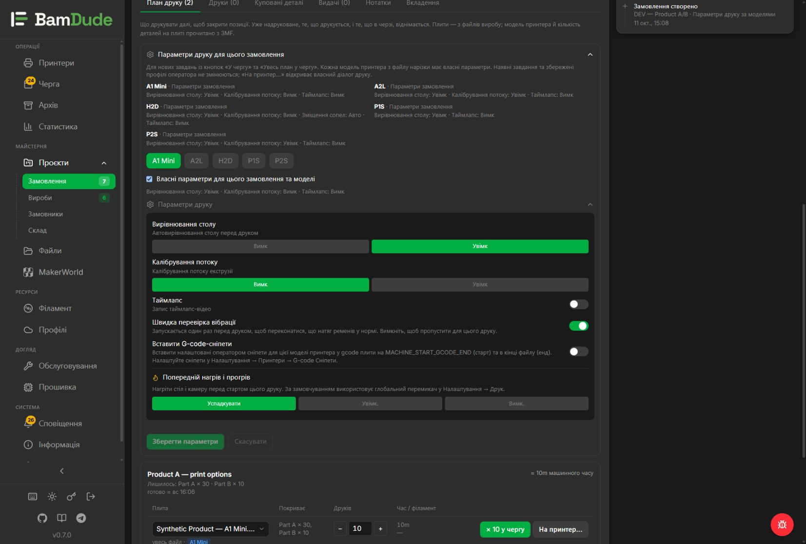
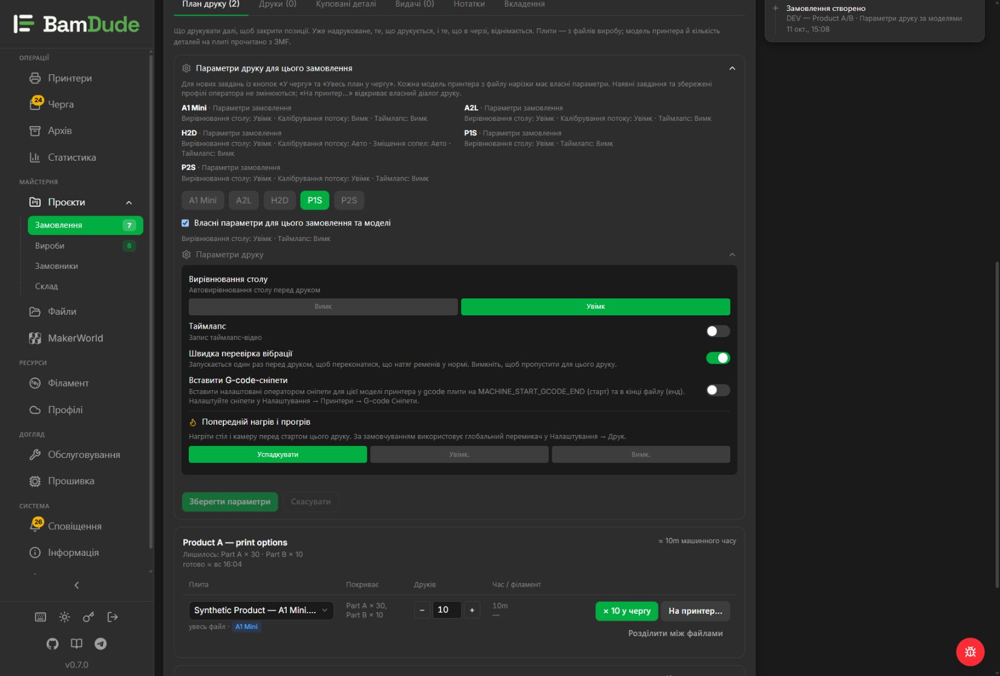
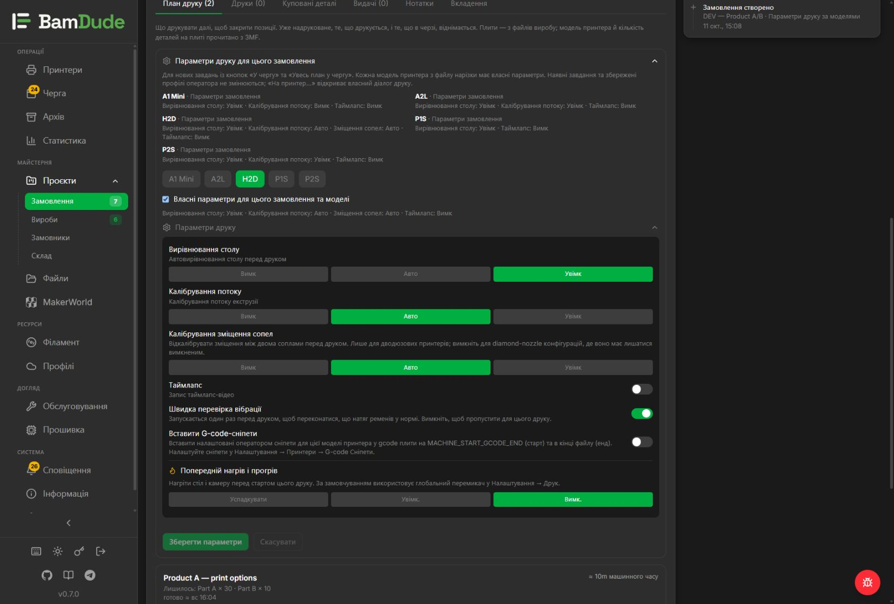
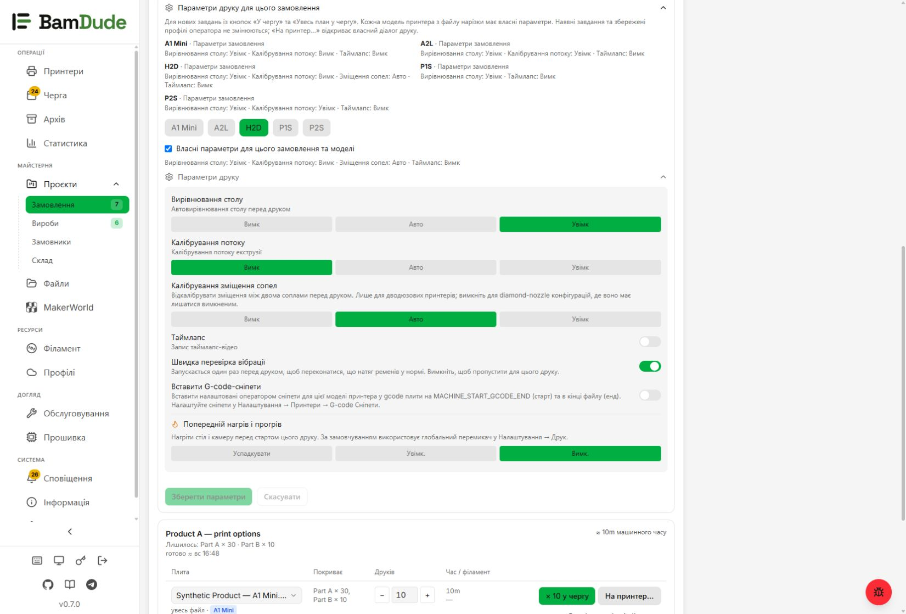

# Print parameters for an order plan

Open an order's **Print plan**, expand **Print parameters for this order**,
select a sliced printer model and enable **Use custom parameters for this order
and model**. Save before using **Queue** or **Queue entire plan**. Cancel restores
the saved choices. Unsaved or saving changes disable both plan queue buttons.

Each model has independent choices. P1S has no flow-calibration control; H2D
offers nozzle-offset calibration. Supported controls and automatic modes come
from the existing mirrored BambuStudio capability catalog, as in the print
dialog. Unknown models cannot receive unverified overrides. File metadata
identifies the sliced model; filenames are only display data.

Only newly created plan jobs receive these overrides. Existing queued jobs and
operator profiles keep their settings. Clearing one model's override returns
that model to operator-profile inheritance. **To printer…** continues to open
the existing interactive print dialog with its own choices.

Auto Queue stores a creation-time copy of the explicit model overrides. When a
job is placed, the captured file's sliced-model values are retained and validated
for the destination. Changing or clearing the routing target without replacing
the file does not select another model's settings. The same rule applies to single
and batch edits of job parameters. Rebalancing to a different sliced file/model uses that model's
entry from the saved copy, rather than the current order. Manual editing changes
only the job's relevant model entry. Existing routing, source/claim checks,
macro constraints and plate-clear admission remain in force.

## API and migration

- `GET /api/v1/projects/{id}/print-options` returns explicit overrides and model
  contexts with inherited/effective parameters and capability gates.
- `PUT /api/v1/projects/{id}/print-options` replaces `{overrides: {...}}`. An empty
  map restores inheritance. Existing order permissions and editability apply.
- Nullable JSON columns in `projects` and `auto_queue_items` require migration
  `m199_order_print_options`. There is no backfill of old jobs. Migration gaps
  are supported by the existing runner; coordinate version allocation at merge.

The implementation reuses `PrintOptionsPanel`, `CalibrationModeControl` and
the existing Pydantic print-toggle schemas. React Hook Form would duplicate the
current controlled form; JSON Forms would add schema renderers and dependencies
for an already finite control set. No scheduler or capability matrix is added.

## Synthetic preview

The screenshots show a Product A/B development fixture. They contain no live
printer camera images or production order data.

